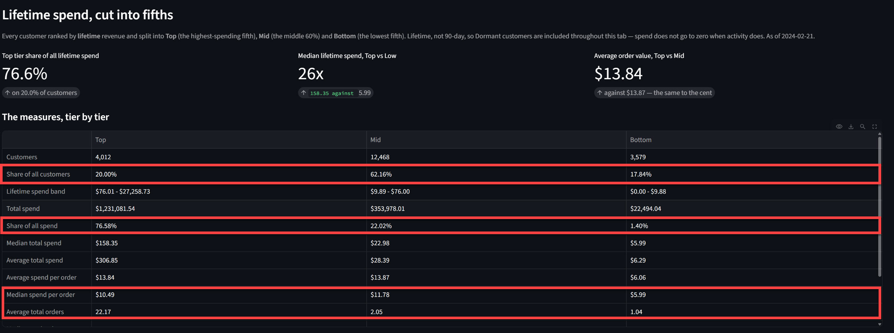

# Notes on Architecture

Using AWS presented a lot of options but there are a few things I wanted to call out in the architecture and why the choices were made.

Because this exercise is to create a daily batch job that includes variable amounts of data, having a fully scalable pipeline where reduced maintenance cost and code traceability were primary concerns. With that in mind the code architecture focused on using .yaml config values to dynamically validate contracts and only after the configs contract is validated, then create spark instances. The .yaml also holds tables schema data and values needed to connect to each data source per environment based on arguments passed into the elastic glue workflow or from the command line for each layer. Glue jobs can also be updated using a gated GitHub CI/CD pipeline through GitHub Actions allowing almost full control of each workflow stage through this controlled environment. A suite of test were created that also runs upon every push to the main branch to ensure new changes does not break existing functionality and the updates are not pushed to the S3 folders unless the tests pass. This allows developers to flexibly update jobs much quicker and with more confidence than developing independent scripts directly in the Glue console while also providing immutability and tracking of every change made to the workflow as well as each individual stage of the pipeline. 

### Storage

There is a split on the type of data format for different pipeline layers. A data lake was created for the raw layer that holds parquet files in S3 object storage manually partitioned on run date to represent the daily nature of this batch job and provide a quick way to access specific runs. The current data size would not require partitioning but this pipeline assumes a much larger volume of data would come through for a large company over the years if deployed in a real production environment. 

The silver, and gold layers are each considered data lakehouses because they store data using Apache Iceberg format in an s3 bucket which holds not only parquet files but metadata folders that allows for Iceberg to operate much more efficiently than pure parquet reads directly using Pyspark alone.

Partitioning in those two layers is applied where it earns its keep rather than everywhere. The rule is to partition what grows on every run and leave entity-grain tables alone. Silver's `order_items` is partitioned by `months(creation_time_utc)` and gold's `daily_restaurant_sales` by `months(sales_date)`. 

Because both accumulate rows with each batch and a month partition lets a query skip entire ranges of unrelated files, especially when paired with Iceberg's ability to record and revert to snapshots using metadata, I feel this is a safe and responsible choice. The rest are deliberately unpartitioned: `date_dim` is a small static dimension, while `customer_lifetime_value` and `customer_rfm` are each one row per entity, so splitting them would add metadata overhead and a scatter of small files without removing any work from a query that reads most of the table anyway. Partitioning a table that fits comfortably in a handful of files costs more than it saves on a dataset of this size, but again was implemented to show understanding of the concept.

 

### Why Iceberg vs Strictly Parquet Updates for Silver and Gold Layers

After the database tables are ingested into flat parquet files in the raw layer Apache Iceberg is implemented through a Glue job in Silver and Gold Layers for multiple reasons. Iceberg features the reduction of object scans by using Hidden Partitioning and column level statistics by maintaining metadata that lists where warehouse files are located, and what data is relevant, stale or unnecessary. This means when performing SCD 1 updates, data can be safely overwritten using standard SQL commands without worry of destroying data due to a crashed run because of its snapshot retrieval capability (Unless a table is dropped, because that destroys the metadata effectively removing prior snapshots but leaves the parquet file itself).

Vendor benchmarks suggest it's cost efficient due to its ability to reduce merge operations by 20-50% for write workloads. If a file doesn't contain the data you're looking for Iceberg would reduce the need to scan unnecessarily, so S3 request cost can be reduced by up to 90% due to its metadata strategy. Statements based on video located [here](https://www.youtube.com/watch?v=VpihapR6550&t=1077s) among other sources, but truly cannot be verified until benchmark tested against an existing dataset.

It should be noted that a pruning strategy regarding metadata should be implemented in a real production environment so we are not keeping metadata indefinitely but possibly archiving records after a specific size or point using AWS S3 Glacier is possible.  
 

### Secrets Manager:

No credentials are kept in the repository. This is important to make sure that proprietary data remains secure throughout the pipeline process. Because the jobs will be dispatched and run through glue the execution role associated with that AWS operation will reference all necessary secrets and provide permissions for each environment respectively. This is done by creating a Role profile linked to a trust policy within AWS that allows GitHub actions to use OpenID Connect to ensure specific subject and audiences are present to allow for the connection not only to the secrets manager but all permissions necessary to update the glue jobs, and access the S3 folders.

 

### AWS Bucket

Because the ingested data will sit in a SQL server, bucket versioning is unnecessary for this daily batch job, unless auditing becomes a major concern. If so CDC for continuous historical auditing or .csv for long term static cold storage would be better options for data recovery. The Buckets are set up with basic SSE-S3 managed key encryption while SSE-KMS is preferred in production corporate environments to maintain explicit audit capability. Because this is a basic project I wanted to eliminate the unnecessary AWS KMS API request cost for this daily batch job. Storage can also be coupled with Glue Table Optimizer to automatically compact and retain snapshots with relatively low effort.

 

### AWS RDS MSSQL Server

Connection is made through a connection string that is built using the secret returned from the AWS RDS Secrets object directly. The certificate for RDS is automatically accepted for dev purposes but in a live production environment should have a downloaded root certificate and placed in a java trust store for the spark job to access most securely.

 

### Medallion Architecture Using SCD1

As there is no business need to maintain old records using SCD1 is the best choice to keep storage cost down as well as the most performant choice when implementing an OLAP layer. Because we are not adding unnecessary columns, aggregations are faster, queries stay lean and scan fewer rows comparatively quickly. The only issue is that the data will only reflect the current state meaning if a client or product moved locations only the most recent record entry for that sale will be reflected. If we wanted to use machine learning to make inferences on ever changing historical data SCD2 would be the most appropriate, but considering the data itself are sales records, this becomes highly unlikely

 

### AWS Glue

The jobs are set up to potentially run daily on a schedule implemented in AWS Glue, or a step function. I wanted to keep everything simple so I used a Glue Workflow for setup but in a live production environment especially if integrating with other AWS or external services the step function would be the better choice.

The individual layer's glue jobs are linked to a hashed folder stored in S3 that updates upon approved CI/CD pipeline builds gated by a release to the production environment. This immutable hash is a part of the folder path referenced by the Glue job. This means the glue job automatically receives the most recent code stored in the S3 bucket linked to the GitHub hashed code, as well as orchestrates the job from start to finish. If there is a specific date that needs to be re-run or re-processed each job and the workflow has been set up to bypass a scheduled event altogether and accept arguments for the specific environment, batch date, or table to be targeted.

 

### Quarantined Data

Quarantined data is kept in a quarantine folder in the S3 bucket and allows the job to complete, even when there is a failed record. Those records can later be reviewed for reprocessing, after inspected and cleaned. If there is a data issue at any point the quarantined records are stored with the results of the glue job at the existing stage with a reason for the failure so that issues can be addressed quickly and inserted at a later time. 

 

### Streamlit

Streamlit uses python to create robust visualizations that are relatively easy to manipulate for the end user, and if setup correctly can help simplify complicated business decisions that involves large amounts of data down to a glance. Though it natively cannot read Iceberg files PyIceberg is used seamlessly to query Iceberg glue tables in the gold layer to render visualizations.

 

# Analysis and Findings
The entire point of the pipeline is to discover insights into the purchasing behavior of customers to improve sales in the long run by looking at historical data. This presented several issues that needed to be considered to gain that accurate picture. 

**The Dataset:**

The data provided ranges from 4/21/20 through 2/21/24, and though this did not cause issues when establishing lifetime values it did cause issues when attempting to research customer behaviors while establishing customer categories based on purchase frequency, recency, and monetary history.

 Not all orders were linked to accounts and were excluded from categorizing customer behaviors because you can't measure what you can't track. There was also a Test Developer Account that was removed to keep the data as accurate as possible. During my analysis I discovered 3 accounts that could be considered outliers in the number of lifetime orders and their overall impact on the data. Because they were real accounts I did include them in my analysis but provided a toggle that could remove or include them in most of my analysis based on user preference. Below is a breakdown of those 3 accounts explained in the Streamlit Visualization:

## Lifetime Spend
I wanted to establish what was driving revenue for the company and establish what characteristics of our consumer's purchase profile could be used to establish insights into not only who our most valuable customers were, but what behaviors to target when marketing to them. First I establish a lifetime spend across the top and bottom 20th percentile and everyone in between. I wanted to not only know their average spend but how many times they ordered, how much they ordered and how often. Below is a screenshot of the developed chart. Notice that the top 20% of customers were responsible for over 76% of our total revenue. 

Per-order spend is essentially identical in the top and middle tiers -- $13.84 against $13.87 -- so the top 20% are not buying bigger baskets, they are buying more often: 10x the middle tier's order count and 20x the bottom's. The bottom tier is different in kind rather than degree, at $6.06 per order with 96.5% of them never placing a second order.

This indicated that the focus shouldn't be on upselling the customers, but to focus on the customers that had a higher order frequency, which would drive their overall monetary value to the company. I wanted to better dig into the recency of the orders by examining what the overall customer value to the company was if they ordered soon after their first purchase and how that activity contributed to their overall lifetime value of the company. Customers who placed a order within 1-3 days did have a much higher lifetime revenue value per customer over those who placed a second order over a month after their initial order, this could be definitional and should not be considered conclusive without more evidence. Most of our customers never place a second order at all. 

Lifetime value numbers are great at determining the behavior driving revenues but marketing requires segmentation to understand what specific customer profiles exist, and must be established for targeted marketing. 

 

## Customer Segments

Built by `python_scripts/silver_to_gold/transforms/customer_rfm.py` into `gold.customer_rfm`, one row per `user_id`. The table is a full rebuild every run (`write: replace`) rather than an incremental one, because a segment describes a customer's whole relationship with the business and an incremental run would classify people on whatever fraction of their orders happened to arrive in that batch.

Each segment was established using statistical outcomes on customer spend, as well as average and median recency days between orders. 90 days from the anchor was used because of its a wide enough time frame to establish customer activity but puts the emphasis on customers behavior now instead of of how they interacted with us in the past. This the best way to focus future marketing efforts for existing lucrative relationships instead of chasing the behavior of the past. The streamlit visualization lists each segment and how customers qualifies:

What each segment means in practice:

- **VIP** -- ordering repeatedly right now, present in an earlier period too, and in the top fifth of 90-day spend. 1.9% of all customers -- 10.3% of the active ones -- producing 38.1% of trailing-90-day revenue, at $133.64 each. This is the group to protect.
- **Loyal** -- frequent and current, but under the spend cut; the natural VIP feeder at $64.74 each. Worth watching: their spend declines across all three periods ($5,098 -> $4,446 -> $3,211 oldest to newest) while VIP spend grows ($15,661 -> $15,397 -> $20,527).
- **Promising** -- current but infrequent, and with an average tenure of 422 days these are established occasional buyers, not newcomers. The name describes the opportunity, not their age.
- **Re-engaging** -- won back after at least 180 days away, 367 on average. Fragile at 40.9%, and the second order is what decides whether the win-back actually held.
- **New** -- first order inside the last 30 days (average tenure 15 days), no prior history to judge them on. They return only 32.4% of the time unaided, which is the whole argument for onboarding and habit-forming follow-up.
- **Slipping** -- had a rhythm of three or more orders in the window and then went quiet inside the last 30 days. At 59.0% they still return more often than not, and at $56.34 each they are worth roughly three Lapsing customers, which makes this the highest-leverage group in the table.
- **Lapsing** -- a rhythm of their own, just a slow one, and currently quiet. 1,085 customers, $21,004 in the window at $19.36 per head, and a median 46.0-day gap they are only 1.25x past. The honest play is cheap and broad rather than individual attention.
- **Never Returned** -- exactly one order in their entire history, placed 30 to 90 days ago. 591 customers, $9,122, and the **highest average order of any segment at $15.44 on 1.82 items** -- they buy the biggest first basket and then vanish. `avg_gap_days` is NULL for all of them because there is no second order to measure a gap against.
- **Dormant** -- no orders at all in the window. 81.4% of all customers, and 4.8% of them come back without being asked.

Two thresholds are calibrated from the data rather than hardcoded:

- **`vip_spend_cut`** is the 80th percentile of `spend_last90d` among **active** customers only, recomputed on every run ($47.94 at this anchor). 90-day spend is badly skewed -- median $20.96, mean $36.30, maximum $887.43 -- so a mean would drift with outliers and still qualify 27% of customers. It is computed over `Window.partitionBy("is_active")` because ranking across everyone would drag the cut toward zero, 81% of customers having no orders in the window at all. The value is written out as a column so a dashboard can display the threshold it used and a reviewer can audit it instead of taking it on trust.
- **`orders_last90d >= 4`** for Loyal is the top fifth of the 90-day order count, whose 80th percentile among active customers is 3.

After breaking our clients into segments based not only on total spend but the actual order frequency cut offs for the top 80th percentile of our clients a clear picture emerges

Because we have established that our most lucrative clients are the ones that order often we need to ensure that the cadence of their orders is consistent with their own past behavior and identify those clients that are not ordering as often. 
  
From the anchor the trailing 90 days are cut into three 30-day periods, each with its own order count and spend:

| period     | column suffix | what it is                                                     |
| ---------- | ------------- | -------------------------------------------------------------- |
| 0-30 days  | `_last_30d`   | the current period; recency is simply whether this is non-zero |
| 31-60 days | `_31_60d`     | the 30-60 day period before the anchor date                |
| 61-90 days | `_61_90d`     | the oldest 60-90 day period before the anchor date             |

`orders_last90d` and `spend_last90d` are the sums of the three. Anything older than 90 days is still kept (`total_orders`, `total_revenue`, `first_order_date`, `tenure_days`) and is useful for history, but it only drives 3 of the segments (New, Re-engaging and Never Returned). The goal is to drive the point that what a customer did two years ago says little about whether they are leaving now.

 
This is where the recency versus the average gap days chart shines and shows where the most efficient marketing spend is justified. By analyzing the anchored 90 day period we are able to establish a normal rhythm they themselves have determined in the prior 60 and 90 day lookback periods that is no longer present in the most recently anchored 30 day period. These customers are named slipping for that reason. 

 
If a customer on average orders every 14.5 days, but havent ordered nearly as much in the past 30 days, we are losing some of our best clients and these are who we should focus on retaining through marketing efforts.
 

   

### Segment groups

`segment_group` rolls the nine segments into seven buckets, so a dashboard filter or a headline number can work at a level a reader can actually act on.

| segment_group  | segments             | customers | 90d spend | the question it answers                      |
| -------------- | -------------------- | --------- | --------- | -------------------------------------------- |
| Core           | VIP, Loyal           | 583       | $64,339   | who is carrying revenue right now            |
| Infrequent     | Lapsing, Re-engaging | 1,279     | $24,108   | who buys rarely but on a rhythm of their own |
| Developing     | Promising            | 618       | $16,186   | who is engaged but has not become habitual   |
| Churn Risk     | Slipping             | 232       | $13,072   | who had a rhythm and broke it                |
| Never Returned | Never Returned       | 591       | $9,122    | who ordered once and never came back         |
| New Growth     | New                  | 431       | $8,734    | who just arrived and still needs onboarding  |
| Dormant        | Dormant              | 16,325    | $0        | the reactivation pool                        |

### What does It Mean for Marketing? 
**Churn Risk holds Slipping alone**, and Lapsing sits under Infrequent instead, because the two were measured and do not behave alike. Dividing `recency_days` by each customer's own `avg_gap_days` puts Slipping at a median of **3.01x its own cadence, with 71.1% of its customers at 2x or worse**; Lapsing sits at **1.22x** -- a 61-day silence against a 46.0-day normal gap, which is close to on schedule. Lapsing customers were occasional from the start and still are, so treating them as churn treats ordinary behaviour as an emergency.

Segmenting the same customers at two anchors 180 days apart confirms it from the other direction. Slipping has the **highest progression to Core of any non-Core segment (8.8%) and the lowest rate of going Dormant (57.2%)** -- it recovers better than Promising develops. That is what makes 232 customers worth individual attention at $443.33 of lifetime revenue each, while 1,279 Infrequent customers warrant broad and cheap treatment.

**Re-engaging moved out of Developing** on the same evidence. Over 180 days it reaches Core **2.3%** of the time against Lapsing's **3.5%**, and goes Dormant **77.4%** of the time against Lapsing's **71.9%** -- worse on both axes than the group it now joins. With a median gap of 143.7 days, clearing the 180-day dormancy bar once is infrequency, not a trajectory, and "Developing" claimed a direction the data does not support.

**Never Returned is split out of Lapsing** because a single lifetime order is not infrequency -- there is no cadence to be infrequent against, and `avg_gap_days` is NULL for every one of them. They reach Core 0.8% of the time and go Dormant 92.5%. Left inside Lapsing they hid 591 failed acquisitions at $15.44 each among 1,085 genuinely habitual-but-slow customers at $19.36 each who hold 86.1% of that pool's lifetime revenue. They are an acquisition-quality problem and they belong beside the second-order analysis, not in a retention bucket.

## Loyalty Program Analysis

The loyalty program didn't exist until March 27th 2023. Because of this we can look at customer aggregate behavior 90 and 180 days prior to and after individuals joined the loyalty program which accounts for close to 2k members that were in both states during the available time period. The results were relatively positive, especially after removing the top three spending/ordering outliers during that period. Before adjustment, orders per customer and visits per customer both increased while orders per visit appeared to fall 10.5%. That fall was entirely the three volume accounts: with them removed, orders per visit is flat at 1.07, which is what makes this a frequency effect rather than a basket effect. Though this effect diminished over time both visits and orders per customer remained higher than the six month period before. 

Here is what this looks like with all orders included

Results after removing the top 3 outliers skewing data:

The outliers overstated the orders per customer rate higher than that our typical customers, but in both states, the impact of the loyalty program is positive. With the outliers removed, the main difference is the increase of the orders per customer percentage jumped dramatically to +20.6% instead of just a +7.7% increase before removing the outliers. Though customers coming back more often does raise overall revenue its not 100% conclusive that the loyalty program is driving the behavior or if these customers would have behaved the same without the loyalty program, but the data suggests that it definitely helps.

In addition to this if we look at members and non members over the same 180 day window we can also see positive impact to the overall activity across all segments for members versus non-members. Loyalty members have a much higher rate of remaining active with us over a 6 month period than non-members.

Using the 90 day lookback period before the last available anchor date it looks like the trend continues. When only focusing on all customers who placed an order with us within the past year loyalty members have a greater chance of returning at all, and show  higher orders per customer, and more visits per customer but the overall totals have not moved:

As explained in the visualization:
The data cannot attribute a dollar amount to the loyalty program — there is no experiment here, the comparison is confounded by who chooses to enrol, and the program launched alongside other changes, so no share of revenue can honestly be assigned to it. What it does support, consistently and across every control applied: loyalty members come back more often, and enrollment is associated with higher orders and visits per customer. That holds in the most recent 90 days, it holds within the same people before and after they joined, and it holds at every level of prior engagement. The direction and the mechanism are clear even though the magnitude is not.

## Sales Trend Monitoring

Understanding beneficial revenue trends required not only revealing amounts over time period but which hours of the day provided the most revenue. Breaking down the amount of sales per hour (assuming American US Eastern time as all times presented as UTC) revealed that a large portion of our revenue was driven during lunch time during the weekday. 

I also wanted to know which day of the week was driving the most sales so a heat map was created to understand which hours of which day on average was generating the most revenue and as it turned out mid day mid week was was the overall winner as shown in the heat map below. 

The charts above when coupled together show lunch time on Thursday and Friday was driving revenue with a steady cooling off emitting outwards is a strong indication that our service is driven by the work crowd so tailoring marketing efforts towards those demographics could be a focus for the marketing team moving forward. 

To further support this assumption I analyzed sales across all holidays for the given periods and was able to determine that though some holidays where people typically work such as Columbus Day, Juneteenth and Veterans Day caused higher than usual revenue other Holiday's where employees get the day off such as Memorial Day, Thanksgiving and Christmas saw a marked reduction in revenue. Holidays overall are are down by 16.4% per open day.

I also wanted to know what products were driving revenue throughout the day. By breaking down the product categories of what was sold and when I was able to determine that Sandwiches and breakfast categories were the top two and also demand for these categories outperformed most of the others throughout the day. 

### So What does this mean for Marketing? 

When looking at the above trends, coupled with the understanding that the more visits per individual customer drives revenues and that customers come to us more often when they are a part of the loyalty program, supports an investment to promote joining the loyalty program during lunch time and breakfast during the holidays of Columbus Day, Juneteenth, and Veteran's Day specifically tailored to the work crowd would be a good isolated measure to improve  revenue to not only draw new customers but keep them so they become a part of our core segment group. This recommendation is based on limited data though. Regardless if action is taken these measures should be tracked by revisiting these same numbers over time to understand if the program has not only reached new customers but if it is also keeping them coming back. 

Individual restaurant performance was also tracked, and the top five restaurants attributed for over half of our revenue. Though the top five restaurants changed when accounting for the outliers the trend remained true.

Top Restaurant Performance With Outliers Included

Top Restaurant Performance With Outliers Excluded
